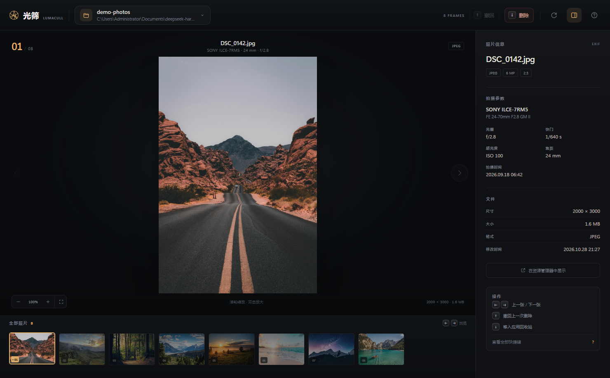

# 光筛 LumaCull

A lightweight Windows photo culling tool that helps photographers quickly review and organize their shots using simple keyboard shortcuts.

[下载 Windows 版](https://github.com/799100389-hue/LumaCull/releases/latest) · [报告问题](https://github.com/799100389-hue/LumaCull/issues)

## 为什么做光筛

拍完照片后，整理和挑选往往需要花费不少时间。我开发光筛，希望让这个过程更简单：用方向键浏览照片，快速筛掉不需要的画面，留下值得保留的瞬间。

> 为摄影师打造的键盘优先选片台。左右浏览，上下定夺，让一整组照片快速沉淀。

光筛是一个本地运行的 Windows 桌面选片工具。它不导入图库、不改动照片内容，只做一件事：用最快的节奏帮你从一组照片里留下想留的那几张。

启动后会打开一个无地址栏的独立应用窗口；界面由本机 Edge / Chrome 渲染，照片始终由本地 Python 服务读取，不会上传。



## 核心操作

| 按键 | 动作 |
| --- | --- |
| `←` / `→` | 上一张 / 下一张 |
| `↓` | 将当前照片移入光筛回收站 |
| `↑` | 撤回最近一次删除 |
| `O` | 打开 / 切换照片文件夹 |
| `R` | 重新扫描当前文件夹 |
| `I` | 显示 / 隐藏右侧照片信息 |
| `+` / `−` | 放大 / 缩小照片 |
| `0` | 适应窗口，复位缩放 |
| `?` | 查看全部快捷键 |
| `Esc` | 关闭弹窗 / 退出放大 |

删除不会直接抹掉文件：照片会被移动到 `%LOCALAPPDATA%\LumaCull\trash`。按 `↑` 可以恢复；即使关闭应用，下次打开同一个文件夹仍能继续撤回。

## 开始使用

### 方式一：直接运行发布包

1. 解压 `LumaCull-Windows-x64.zip`。
2. 双击 `LumaCull\LumaCull.exe`。
3. 点击「打开照片文件夹」，或直接按 `O`。

启动器会打开一个独立的无地址栏窗口；它不占用你日常浏览器的标签页。电脑上需要安装 Microsoft Edge（Windows 10/11 默认自带）或 Google Chrome。

> 兼容性说明：界面只加载本机 `127.0.0.1` 页面，不打开外部网页。为避免部分 Windows 安全策略拦截 Edge 的 AppContainer 渲染进程、导致窗口空白，启动器会关闭这一层 AppContainer 隔离；Chromium 的其余沙箱层仍然保留。

首次启动时 Windows SmartScreen 可能提示“未知发布者”，因为程序没有购买代码签名证书。点击「更多信息」→「仍要运行」即可。

### 方式二：从源码运行

需要 Python 3.10+（Windows）。

```powershell
cd LumaCull
python -m pip install -r requirements.txt
python app.py
```

也可以直接双击 `run.pyw` 启动（不会显示控制台窗口）。

### 从命令行打开指定文件夹

```powershell
python app.py "D:\Photos\2026-10-18 婚礼"
```

`LumaCull.exe` 同样支持这种方式，适合建立一个“用光筛打开”的右键菜单或快捷方式。

## 功能细节

- **键盘优先**：所有选片动作都能在不碰鼠标的情况下完成。
- **快速预览**：缩略图与 2800px 预览按需生成，原图不被修改。
- **EXIF 信息**：显示机身、镜头、光圈、快门、ISO、焦距与拍摄时间。
- **安全删除**：应用内回收站 + 可持久化撤回记录。
- **胶片栏**：自动定位当前照片，支持鼠标点选。
- **缩放查看**：滚轮、双击、`+ / −` 均可，可拖动查看细节。
- **欢迎页最近文件夹**：快速回到上一组照片。
- **本地优先**：照片只在本机读取，不上传任何内容。

### 支持格式

JPEG、PNG、WebP、BMP、GIF（首帧）、TIFF、HEIC / HEIF。

暂不支持相机 RAW 格式（CR2 / NEF / ARW / DNG 等）。扫描范围是当前文件夹的**第一层**，不会递归进入子文件夹，视频文件会自动忽略。

## 数据与隐私

| 内容 | 位置 |
| --- | --- |
| 最近打开 | `%APPDATA%\LumaCull\settings.json` |
| 撤回记录 | `%APPDATA%\LumaCull\undo.json` |
| 应用回收站 | `%LOCALAPPDATA%\LumaCull\trash` |
| 缩略图缓存 | `%LOCALAPPDATA%\LumaCull\cache\thumbs` |
| 运行日志 | `%LOCALAPPDATA%\LumaCull\lumacull.log` |
| 独立窗口的浏览器配置 | `%LOCALAPPDATA%\LumaCull\browser` |

- 照片不会上传到任何服务器。
- 应用回收站中的文件不会自动清理；确认不再需要后，可以手动删除该目录。
- 撤回记录保留最近 80 条，按文件夹区分。

## 开发

### 项目结构

```text
LumaCull/
├─ app.py                  # 启动入口
├─ run.pyw                 # 无控制台启动入口
├─ lumacull/
│  ├─ desktop.py           # 应用窗口启动、单实例、心跳与退出
│  ├─ server.py            # 本地 HTTP 服务与 API 路由
│  ├─ library.py           # 文件夹扫描、删除/撤回、最近记录
│  ├─ imaging.py           # 缩略图、预览、EXIF、HEIC
│  ├─ store.py             # 原子写入的 JSON 设置与撤回日志
│  └─ config.py            # 路径与常量
├─ web/                    # 原生 HTML/CSS/JS 界面（无前端构建步骤）
├─ assets/                 # 应用图标
├─ docs/screenshots/       # 文档截图
├─ build.ps1               # 一键打包脚本
├─ requirements.txt
└─ LumaCull.spec
```

### 运行测试

```powershell
python -m py_compile app.py lumacull\*.py
```

应用内部使用本地 HTTP 服务，只绑定 `127.0.0.1`，并带有每次启动随机生成的访问令牌。图片请求同样需要令牌。窗口关闭后，应用会通过心跳与关闭信号自动退出，不会留下长期后台进程。

### 打包 Windows 可执行文件

```powershell
powershell -ExecutionPolicy Bypass -File build.ps1
```

产物在 `dist\LumaCull\LumaCull.exe`，发布压缩包在 `dist\LumaCull-Windows-x64.zip`。打包使用 PyInstaller 的 onedir 模式，启动速度比 onefile 更快，也更不容易被杀毒软件误报。

## 设计说明

界面使用深色工作台与暖金色强调色：深色让照片成为视觉中心，暖金用于当前帧、当前操作和可撤回状态。右侧信息栏尽量安静，避免与照片抢注意力；所有关键操作都保留键盘提示。

欢迎页的照片来自 Unsplash，仅作为界面装饰，详见 [THIRD_PARTY.md](THIRD_PARTY.md)。

## 已知边界

- 不读取/编辑 RAW，不改变照片本身。
- 删除是移动到应用回收站，不是 Windows 系统回收站。
- 应用不提供“永久删除”与“回收站管理”界面；请按需手动清理目录。
- 不做多文件夹批量导入、标签、星级、颜色标记等图库功能——这个版本专注“快速筛掉，留下好照片”。

## License

源码采用 [MIT License](LICENSE)。随附的 Unsplash 照片遵循 Unsplash License，详见 [THIRD_PARTY.md](THIRD_PARTY.md)。
